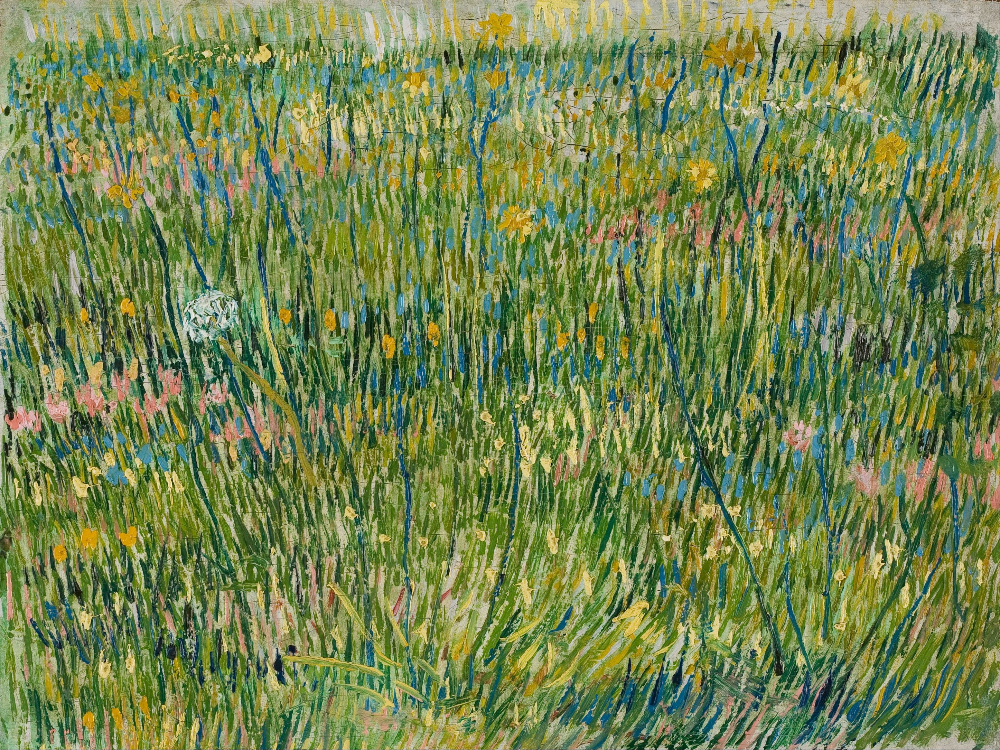
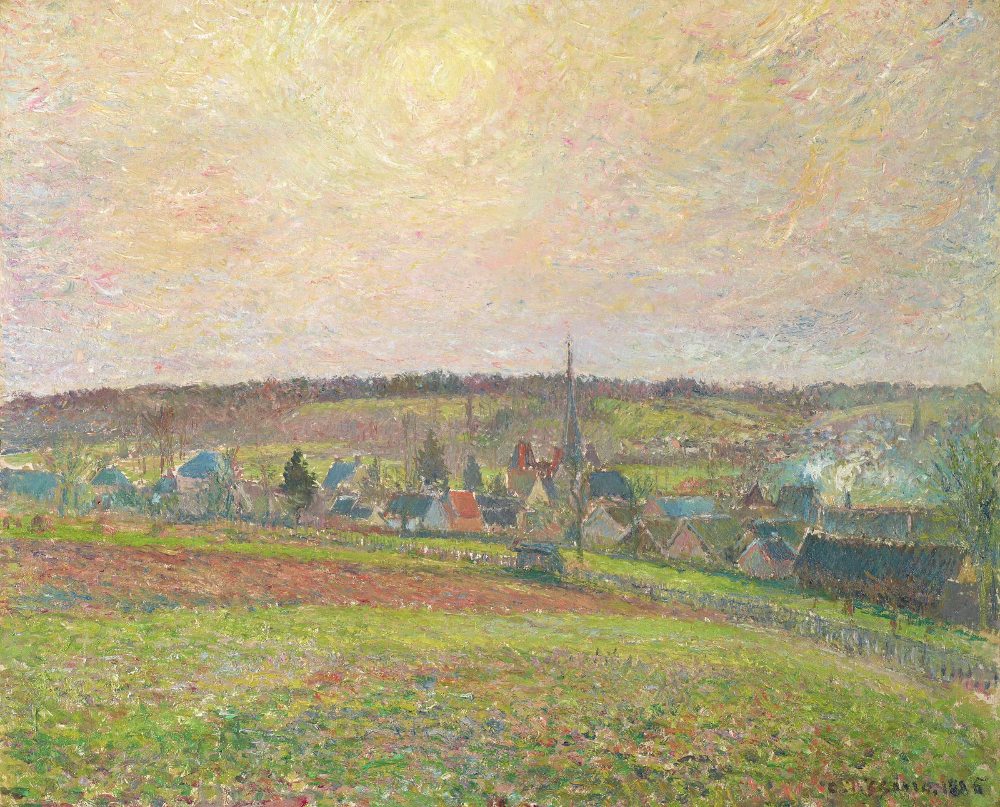

# Arch Linux · niri dots

Configuración personal de niri con Caelestia, Vicinae y Kitty. Paletas inspiradas en pintura, transparencias y wallpapers de arte. Guardada antes de migrar a KDE Plasma 6.

## Wallpapers





Estas imágenes muestran los wallpapers, no capturas del escritorio.

## Qué incluye

| Pieza | Configuración |
|---|---|
| Compositor | niri; teclado US/Latam con Alt+Shift |
| Shell | Caelestia sobre Quickshell |
| Lanzador | Vicinae; Fuzzel como herramienta auxiliar |
| Terminal | Kitty, Zsh, JetBrainsMono Nerd Font |
| Fondo | swaybg y scripts de recuperación del wallpaper |
| Apariencia | Paletas Van Gogh / Impressionist, GTK, Qt, Papirus, Bibata |
| Portapapeles | wl-clipboard, cliphist y selector propio |
| Portátil convertible | Rotación, gestos táctiles, brillo y energía |
| Audio | PipeWire, WirePlumber y scripts para Sony WH-1000XM4 / DAC USB |

`home/` refleja las rutas de los archivos dentro del directorio personal. `system/` conserva la configuración de greetd como referencia. `packages/` separa paquetes oficiales y AUR e incluye sus versiones al guardar los dots.

## Atajos principales

| Atajo | Acción |
|---|---|
| Mod+T | Kitty |
| Mod+Espacio | Vicinae |
| Mod+Ctrl+P | Selector de wallpaper y estilo |
| Mod+Alt+V | Elegir elemento del portapapeles |
| Mod+Alt+B | Borrar elemento del portapapeles |
| Mod+Ctrl+V | Pegar última imagen |
| Super+Alt+L | Bloquear con Caelestia |
| Mod+Alt+D | No molestar |
| Mod+Alt+C | Mantener despierto |
| Mod+Alt+M / Mod+Alt+L | Perfil de audio música / llamadas |
| Mod+Coma | Distribución de cuatro ventanas |
| F3 / F4 | Ajuste fino del brillo |

Consulta `home/.config/niri/config.kdl` para el mapa completo.

## Restauración en mi equipo

Haz un respaldo de tus configuraciones actuales antes de copiar. Estos dots conservan rutas absolutas `/home/lav`, pantalla `eDP-1`, opciones de NVIDIA, dispositivos de audio y ajustes del portátil. Para otro usuario o hardware, adapta las rutas y esos valores en una copia del repositorio antes de instalar.

1. Instala las dependencias que vayas a usar. Las listas reflejan este escritorio; las herramientas de audio, rotación y Howdy son opcionales según el equipo.
2. Desde una sesión fuera de niri, copia las configuraciones elegidas de `home/` a las mismas rutas de tu directorio personal. No copies todo sobre una sesión Plasma sin revisar: GTK, Qt y audio son configuraciones compartidas.
3. Asegura que `~/.local/bin` está en `PATH`, como en `.zshrc`.
4. El comando `caelestia` de este equipo se resuelve a `/usr/local/bin/caelestia`, un enlace a `~/.local/bin/caelestia-wrapper`; el wrapper ejecuta la CLI real en `/usr/bin/caelestia`. Para recuperar la grabación personalizada, recrea ese enlace después de revisar el script.
5. Inicializa el wallpaper, por ejemplo:

```bash
mkdir -p "$HOME/.local/state/caelestia/wallpaper"
printf '%s\n' "$HOME/Pictures/Wallpapers/Vincent_van_Gogh_-_Patch_of_grass_-_Google_Art_Project.jpg" > "$HOME/.local/state/caelestia/user-wallpaper.path"
caelestia wallpaper -f "$HOME/Pictures/Wallpapers/Vincent_van_Gogh_-_Patch_of_grass_-_Google_Art_Project.jpg" --no-smart
```

6. Ejecuta `niri validate` y `systemctl --user daemon-reload`. En una sesión niri, inicia los servicios que necesites:

```bash
systemctl --user start swaybg-wallpaper.service caelestia-wallpaper-guard.service
systemctl --user start niri-autorotate.service niri-touch-gestures.service niri-power-manager.service
# Opcional, para este equipo de audio:
systemctl --user start audio-route.service
```

Las unidades originales usan `WantedBy=default.target`: habilitarlas sin adaptar su arranque puede ejecutarlas también en Plasma. Se conservan como respaldo y no se habilitan automáticamente al copiar el repositorio.

## Detalles de esta copia

- La configuración principal usa Vicinae; la de Fuzzel es auxiliar y conserva su configuración original, incluidas dos secciones de colores y una referencia a Foot, que no está instalado en la captura del sistema.
- `sync-wallpaper-theme` conserva un bloque para Ironbar de una configuración anterior. Ironbar y sus temas no están presentes en esta copia; ese bloque necesitaría retirarse o restaurarse antes de reutilizarlo en una instalación nueva.
- Los ajustes de Qt conservan una referencia a Darkly; revisa la disponibilidad del estilo en el equipo de destino.
- Caelestia tiene integración Howdy activada; el paquete, configuración de PAM y datos biométricos se gestionan aparte.
- Las fuentes Apple locales, credenciales, sesiones de aplicaciones, historiales y capturas privadas quedan fuera del repositorio. Las fuentes Apple permanecen únicamente en el respaldo local.
- Las versiones en `packages/versions.txt` son una fotografía de la instalación, no una garantía de compatibilidad con futuras versiones de Arch.

## Créditos

- [niri](https://github.com/YaLTeR/niri)
- [Caelestia](https://github.com/caelestia-dots)
- [Vicinae](https://github.com/vicinaehq/vicinae)
- [Kitty](https://sw.kovidgoyal.net/kitty/)
- [Bibata](https://github.com/ful1e5/Bibata_Cursor)

Los archivos de terceros conservan sus derechos y licencias originales. El primer wallpaper se identifica por su nombre como *Patch of Grass* de Vincent van Gogh, procedente de Google Art Project; el segundo conserva su nombre de archivo original. No se asigna una licencia global a imágenes, cursores ni código de terceros.
